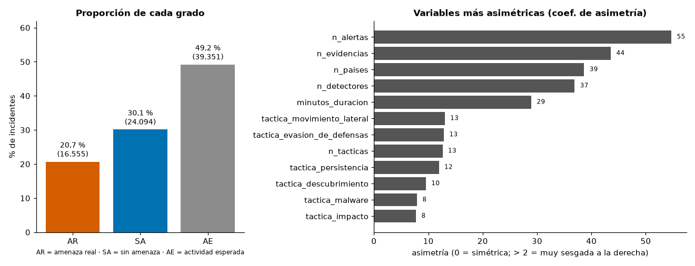
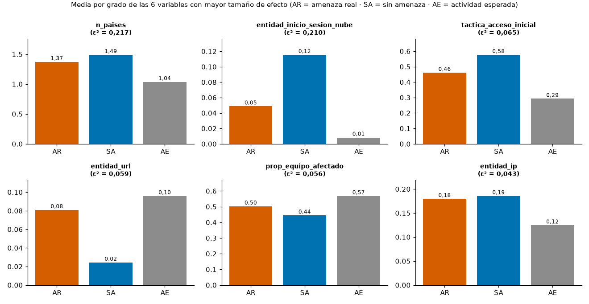
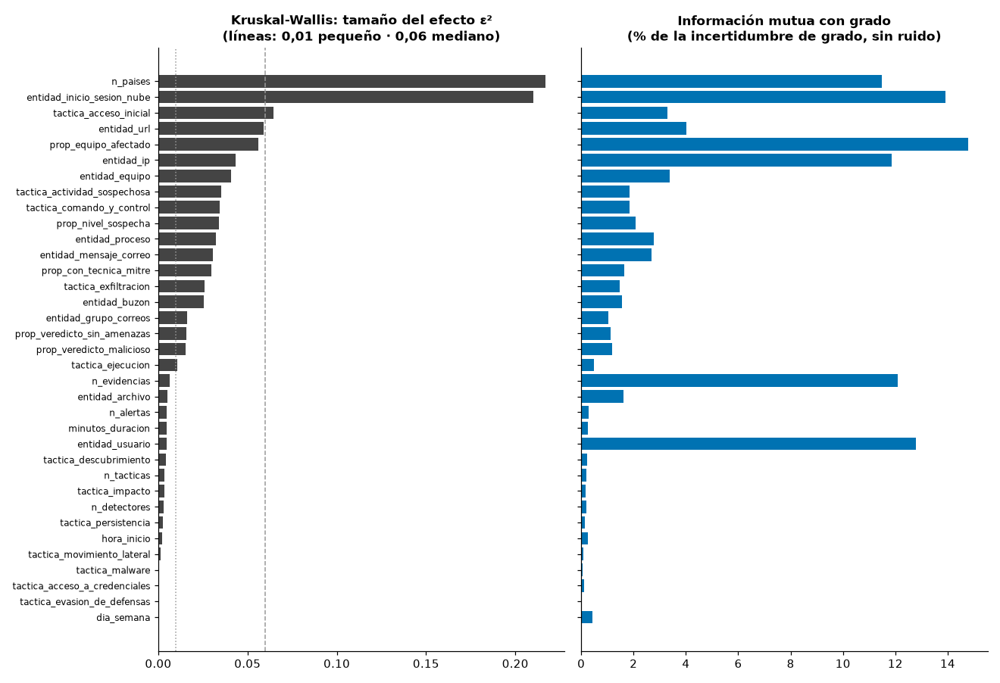
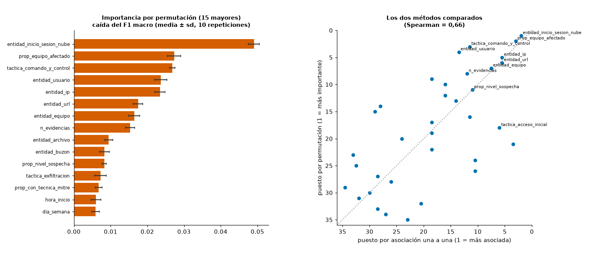
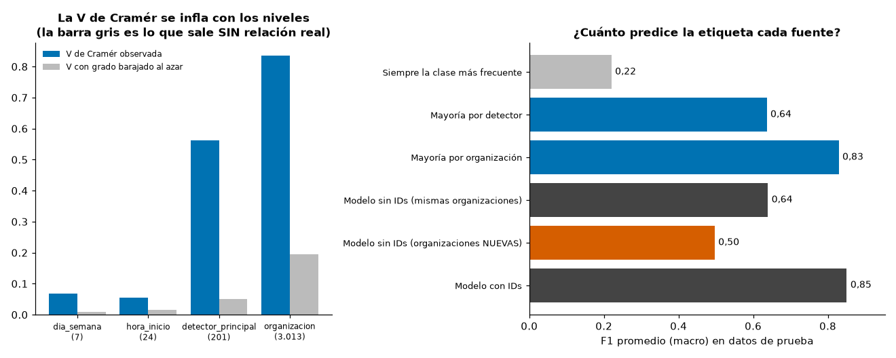

# Qué variables se relacionan con la etiqueta `grado` en 80.000 incidentes de SOC (GUIDE)

**Datos:** `datos/guide_incidentes.csv` (80.000 incidentes, muestra del conjunto GUIDE de Microsoft; el CSV no se modifica). **Alcance:** analítica descriptiva de la base completa, no un modelo para producción. **Reproducir:** `python salida_demo/analisis.py` (semilla fija = 42; tarda unos 8 minutos por los gradient boosting). Todas las cifras de este reporte las produce ese script.

**Convenciones.** AR = amenaza real · SA = sin amenaza · AE = actividad esperada. ε² = tamaño del efecto de Kruskal-Wallis (H/(n−1); convención habitual: <0,01 insignificante, <0,06 pequeño, <0,14 mediano, ≥0,14 grande). MI % = información mutua con `grado` descontando el ruido que da el azar, expresada como % de la incertidumbre de `grado`. PI = importancia por permutación (caída del F1 macro en el 30 % de prueba al barajar la variable).

## 1. Calidad y estructura

| Indicador | valor |
|---|---|
| Filas | 80.000 |
| Columnas | 38 |
| Tipos de columna | float64: 28, int64: 9, str: 1 |
| Valores nulos (total) | 0 |
| Filas duplicadas exactas (las 38 columnas, contando cada copia sobrante) | 16.993 (21,2 %) |
| Filas repetidas ignorando `grado` | 17.483 |
| Mismas características pero etiquetas distintas | 466 grupos / 3.303 filas |

**Proporción de cada grado**

| grado | incidentes | % |
|---|---|---|
| amenaza real | 16.555 | 20,7 % |
| sin amenaza | 24.094 | 30,1 % |
| actividad esperada | 39.351 | 49,2 % |

La clase mayoritaria es «actividad esperada». Un clasificador que siempre diga eso obtiene F1 macro = 0,220 en la partición de prueba (el piso para comparar).


**Reglas de coherencia (cuántas filas las violan o cumplen)**

| Regla | filas |
|---|---|
| Proporciones fuera de [0, 1] | 0 |
| hora_inicio fuera de 0–23 | 0 |
| dia_semana fuera de 0–6 | 0 |
| minutos_duracion negativos | 0 |
| n_alertas < 1 | 0 |
| n_detectores > n_alertas | 0 |
| n_evidencias < n_alertas | 0 |
| n_tacticas > n_alertas | 0 |
| Suma de tactica_* > 1 | 0 |
| Suma de tactica_* = 0 (ninguna táctica registrada) | 630 |
| Suma de entidad_* > 1 | 0 |
| Suma de entidad_* < 0,99 (tipos de entidad no incluidos) | 26.347 |
| n_alertas = 1 pero minutos_duracion > 0 | 0 |
| detector_principal = -1 (detector poco común) | 9.953 |

Lectura:

- **No hay nulos ni valores imposibles** (proporciones fuera de [0, 1], horas o días fuera de rango, duraciones negativas): las primeras ocho reglas dan 0.
- **Duplicados.** 16.993 filas (21,2 %) son copias exactas de otra. Todas son incidentes de **una sola alerta** (entre los incidentes de 1 alerta, 24,1 % están repetidos; entre los de más de una alerta, 0,0 %), y la copia más repetida aparece 86 veces. No las eliminé en el análisis principal (el pedido es la base completa), pero **sí importan**: (a) en la partición 70/30, 28,3 % de las filas de prueba tienen un gemelo exacto en entrenamiento, lo que infla el F1; (b) hay 466 grupos de filas idénticas con etiquetas distintas (3.303 filas): con estas variables dos incidentes indistinguibles recibieron etiquetas distintas: o difieren en algo que el CSV no recoge, o el criterio del analista no fue consistente. En ambos casos hay un techo a lo que estas variables pueden explicar. En la sección 4b repito el análisis sin duplicados.
- **Valores extremos reales, no errores:** hay incidentes con hasta 3.224 alertas, 10.147 evidencias y 80 países (detalle en la sección 2). No puedo saber con estos datos si son campañas masivas o artefactos de cómo se agrupan las alertas; los dejé tal cual porque las medidas que uso (rangos, deciles, árboles) no se distorsionan por ellos.
- **`tactica_*` suma 0 en 630 incidentes** (ninguna alerta traía táctica MITRE). **`entidad_*` suma menos de 0,99 en 26.347 incidentes**: el CSV solo conserva 10 tipos de entidad, el resto no está.
- `detector_principal = -1` (9.953 incidentes) no es «faltante», sino «detector fuera de los 200 más comunes».

## 2. Descriptivo de la base completa

**Variables numéricas** (35). `p99` y `máx/p99` sirven para ver extremos; asimétrica = |coef. de asimetría| > 2; valores extremos = máx ≥ 5 × p99 (umbrales míos, no una norma). En las variables de proporción (0–1) «asimétrica» solo significa «casi todo ceros».

| variable | media | mediana | p90 | p99 | máx | % ceros | asimetría | señal |
|---|---|---|---|---|---|---|---|---|
| n_alertas | 2,466 | 1 | 2 | 10 | 3.224 | 0,0 % | 54,7 | asimétrica, valores extremos |
| n_evidencias | 14,291 | 4 | 14 | 110 | 10.147 | 0,0 % | 43,6 | asimétrica, valores extremos |
| n_detectores | 1,058 | 1 | 1 | 2 | 60 | 0,0 % | 36,9 | asimétrica, valores extremos |
| n_tacticas | 1,028 | 1 | 1 | 2 | 10 | 0,0 % | 12,6 | asimétrica, valores extremos |
| minutos_duracion | 65,456 | 0 | 100,600 | 766,004 | 36.368 | 88,0 % | 29,0 | asimétrica, valores extremos, casi todo ceros |
| hora_inicio | 12,329 | 13 | 21 | 23 | 23 | 3,9 % | -0,2 | — |
| dia_semana | 2,427 | 2 | 5 | 6 | 6 | 17,5 % | 0,3 | — |
| n_paises | 1,242 | 1 | 2 | 3 | 80 | 0,0 % | 38,7 | asimétrica, valores extremos |
| prop_con_tecnica_mitre | 0,346 | 0 | 1 | 1 | 1 | 65,0 % | 0,6 | — |
| prop_nivel_sospecha | 0,177 | 0 | 1 | 1 | 1 | 81,8 % | 1,7 | casi todo ceros |
| prop_veredicto_malicioso | 0,034 | 0 | 0 | 0,500 | 0,992 | 90,7 % | 3,5 | asimétrica, casi todo ceros |
| prop_veredicto_sin_amenazas | 0,033 | 0 | 0,080 | 0,571 | 0,833 | 89,8 % | 3,6 | asimétrica, casi todo ceros |
| prop_equipo_afectado | 0,517 | 0,444 | 1 | 1 | 1 | 3,2 % | 0,4 | — |
| tactica_acceso_inicial | 0,413 | 0 | 1 | 1 | 1 | 58,6 % | 0,4 | — |
| tactica_exfiltracion | 0,130 | 0 | 1 | 1 | 1 | 86,9 % | 2,2 | asimétrica, casi todo ceros |
| tactica_actividad_sospechosa | 0,193 | 0 | 1 | 1 | 1 | 80,0 % | 1,6 | — |
| tactica_comando_y_control | 0,108 | 0 | 1 | 1 | 1 | 88,5 % | 2,5 | asimétrica, casi todo ceros |
| tactica_impacto | 0,016 | 0 | 0 | 1 | 1 | 98,4 % | 7,7 | asimétrica, casi todo ceros |
| tactica_acceso_a_credenciales | 0,029 | 0 | 0 | 1 | 1 | 96,8 % | 5,6 | asimétrica, casi todo ceros |
| tactica_ejecucion | 0,058 | 0 | 0 | 1 | 1 | 94,1 % | 3,8 | asimétrica, casi todo ceros |
| tactica_malware | 0,015 | 0 | 0 | 1 | 1 | 98,3 % | 7,9 | asimétrica, casi todo ceros |
| tactica_descubrimiento | 0,011 | 0 | 0 | 0,727 | 1 | 98,8 % | 9,6 | asimétrica, casi todo ceros |
| tactica_persistencia | 0,007 | 0 | 0 | 0 | 1 | 99,2 % | 11,9 | asimétrica, casi todo ceros |
| tactica_evasion_de_defensas | 0,006 | 0 | 0 | 0 | 1 | 99,3 % | 12,9 | asimétrica, casi todo ceros |
| tactica_movimiento_lateral | 0,006 | 0 | 0 | 0 | 1 | 99,4 % | 13,0 | asimétrica, casi todo ceros |
| entidad_ip | 0,154 | 0 | 0,333 | 1 | 1 | 51,0 % | 1,6 | — |
| entidad_usuario | 0,238 | 0,250 | 0,333 | 1 | 1 | 12,9 % | 1,2 | — |
| entidad_mensaje_correo | 0,108 | 0 | 0,333 | 0,833 | 1 | 72,1 % | 1,9 | — |
| entidad_equipo | 0,075 | 0 | 0,250 | 1 | 1 | 72,2 % | 3,2 | asimétrica |
| entidad_inicio_sesion_nube | 0,049 | 0 | 0,250 | 0,333 | 0,333 | 81,6 % | 1,7 | casi todo ceros |
| entidad_url | 0,071 | 0 | 0,400 | 0,500 | 1 | 78,0 % | 2,1 | asimétrica |
| entidad_archivo | 0,063 | 0 | 0,333 | 0,625 | 1 | 80,9 % | 2,5 | asimétrica, casi todo ceros |
| entidad_buzon | 0,067 | 0 | 0,333 | 0,500 | 1 | 77,8 % | 2,3 | asimétrica |
| entidad_proceso | 0,041 | 0 | 0,200 | 0,333 | 1 | 81,0 % | 2,6 | asimétrica, casi todo ceros |
| entidad_grupo_correos | 0,022 | 0 | 0,077 | 0,250 | 1 | 89,5 % | 6,4 | asimétrica, casi todo ceros |

Lectura:

- **Valores extremos:** `n_alertas`, `n_evidencias`, `n_detectores`, `n_tacticas`, `minutos_duracion`, `n_paises`. Son las de tamaño/duración: la mediana es 1 alerta y 4 evidencias, pero el máximo llega a 3.224 y 10.147. La media engaña: `n_evidencias` tiene media 14,3 y p90 14.
- **`minutos_duracion` es casi siempre 0** (88,0 %): la mayoría de incidentes son de una sola alerta, sin duración medible. Su p90 es 100,6 minutos y el máximo 36.368 (≈ 25 días).
- **Casi todas las `tactica_*` son raras:** las de persistencia, evasión de defensas y movimiento lateral valen 0 en más del 99,2 % de los incidentes. Con tan pocos casos, cualquier conclusión sobre ellas es frágil.
- **Casi simétricas:** `hora_inicio` y `dia_semana` (asimetría -0,24 y 0,34); el día 3 es el más frecuente.

**Variables categóricas / de identificación**

| variable | niveles | más frecuentes (n; %) |
|---|---|---|
| organizacion | 3.013 | 11 (3.151; 3,9 %), 3 (2.131; 2,7 %), 18 (2.124; 2,7 %), 16 (1.813; 2,3 %) |
| detector_principal | 201 | 0 (10.016; 12,5 %), -1 (9.953; 12,4 %), 5 (8.460; 10,6 %), 2 (7.459; 9,3 %) |
| dia_semana | 7 | 3 (15.192; 19,0 %), 2 (14.435; 18,0 %), 1 (14.209; 17,8 %), 0 (13.995; 17,5 %) |
| hora_inicio | 24 | 16 (4.332; 5,4 %), 15 (4.211; 5,3 %), 18 (4.110; 5,1 %), 17 (4.077; 5,1 %) |
| grado | 3 | actividad esperada (39.351; 49,2 %), sin amenaza (24.094; 30,1 %), amenaza real (16.555; 20,7 %) |



## 3. Contraste de cada variable con `grado`

Media y mediana por etiqueta, ordenadas por tamaño del efecto (ε², sección 4). Con tantos ceros la mediana casi siempre es 0 (no discrimina); por eso muestro también la media. Los gráficos solo cubren las 6 variables más llamativas.

| variable | media AR | media SA | media AE | mediana AR | mediana SA | mediana AE | ε² |
|---|---|---|---|---|---|---|---|
| n_paises | 1,372 | 1,489 | 1,037 | 1 | 1 | 1 | 0,217 |
| entidad_inicio_sesion_nube | 0,049 | 0,115 | 0,008 | 0 | 0 | 0 | 0,210 |
| tactica_acceso_inicial | 0,461 | 0,577 | 0,292 | 0 | 1 | 0 | 0,065 |
| entidad_url | 0,081 | 0,024 | 0,096 | 0 | 0 | 0 | 0,059 |
| prop_equipo_afectado | 0,502 | 0,444 | 0,568 | 0,500 | 0,333 | 0,500 | 0,056 |
| entidad_ip | 0,180 | 0,185 | 0,125 | 0,143 | 0,250 | 0 | 0,043 |
| entidad_equipo | 0,052 | 0,048 | 0,101 | 0 | 0 | 0 | 0,041 |
| tactica_actividad_sospechosa | 0,312 | 0,105 | 0,196 | 0 | 0 | 0 | 0,035 |
| tactica_comando_y_control | 0,080 | 0,039 | 0,162 | 0 | 0 | 0 | 0,035 |
| prop_nivel_sospecha | 0,170 | 0,079 | 0,239 | 0 | 0 | 0 | 0,034 |
| entidad_proceso | 0,033 | 0,024 | 0,056 | 0 | 0 | 0 | 0,032 |
| entidad_mensaje_correo | 0,087 | 0,069 | 0,141 | 0 | 0 | 0 | 0,030 |
| prop_con_tecnica_mitre | 0,298 | 0,471 | 0,289 | 0 | 0 | 0 | 0,030 |
| tactica_exfiltracion | 0,037 | 0,118 | 0,177 | 0 | 0 | 0 | 0,026 |
| entidad_buzon | 0,091 | 0,038 | 0,076 | 0 | 0 | 0 | 0,025 |
| entidad_grupo_correos | 0,026 | 0,010 | 0,028 | 0 | 0 | 0 | 0,016 |
| prop_veredicto_sin_amenazas | 0,043 | 0,017 | 0,039 | 0 | 0 | 0 | 0,016 |
| prop_veredicto_malicioso | 0,050 | 0,014 | 0,040 | 0 | 0 | 0 | 0,015 |
| tactica_ejecucion | 0,036 | 0,094 | 0,045 | 0 | 0 | 0 | 0,011 |
| n_evidencias | 24,030 | 11,130 | 12,129 | 3 | 4 | 5 | 0,007 |
| entidad_archivo | 0,046 | 0,075 | 0,063 | 0 | 0 | 0 | 0,005 |
| n_alertas | 5,796 | 1,505 | 1,653 | 1 | 1 | 1 | 0,005 |
| minutos_duracion | 98,757 | 46,767 | 62,889 | 0 | 0 | 0 | 0,005 |
| entidad_usuario | 0,243 | 0,235 | 0,238 | 0,267 | 0,250 | 0,200 | 0,005 |
| tactica_descubrimiento | 0,004 | 0,004 | 0,017 | 0 | 0 | 0 | 0,004 |
| n_tacticas | 1,031 | 1,012 | 1,036 | 1 | 1 | 1 | 0,004 |
| tactica_impacto | 0,011 | 0,008 | 0,023 | 0 | 0 | 0 | 0,003 |
| n_detectores | 1,076 | 1,032 | 1,067 | 1 | 1 | 1 | 0,003 |
| tactica_persistencia | 0,001 | 0,004 | 0,011 | 0 | 0 | 0 | 0,003 |
| hora_inicio | 11,947 | 12,061 | 12,653 | 13 | 13 | 14 | 0,002 |
| tactica_movimiento_lateral | 0,001 | 0,005 | 0,008 | 0 | 0 | 0 | 0,001 |
| tactica_malware | 0,019 | 0,012 | 0,015 | 0 | 0 | 0 | 0,000 |
| tactica_acceso_a_credenciales | 0,026 | 0,026 | 0,032 | 0 | 0 | 0 | 0,000 |
| tactica_evasion_de_defensas | 0,007 | 0,005 | 0,007 | 0 | 0 | 0 | 0,000 |
| dia_semana | 2,486 | 2,424 | 2,404 | 2 | 2 | 2 | 0,000 |

Lectura:

- Solo 6 de las 35 variables tienen medianas distintas entre las tres etiquetas; en las demás la mediana es la misma (casi siempre 0) y la diferencia está en las colas o en el porcentaje de incidentes con valor distinto de cero.
- Las seis más llamativas por tamaño del efecto: `n_paises`, `entidad_inicio_sesion_nube`, `tactica_acceso_inicial`, `entidad_url`, `prop_equipo_afectado`, `entidad_ip` (figura abajo).
- **`n_paises` y `entidad_inicio_sesion_nube`** son las dos de mayor efecto y están casi calcadas: Spearman 0,97; de los incidentes con más de un país, 97,3 % tienen inicios de sesión en la nube (hipótesis: el país solo se registra en las evidencias de inicio de sesión). Por número de países, según la tabla:

| n_paises | incidentes | amenaza real | sin amenaza | actividad esperada |
|---|---|---|---|---|
| 1 | 64.858 | 21,2 % | 20,1 % | 58,7 % |
| 2 | 13.542 | 15,2 % | 76,6 % | 8,2 % |
| 3 | 1.424 | 42,0 % | 46,6 % | 11,4 % |
| 4 o más | 176 | 89,2 % | 8,5 % | 2,3 % |



## 4. Impacto sobre la etiqueta con dos métodos distintos

### 4a. Asociación una a una (sin controlar por las demás)

Kruskal-Wallis compara las tres etiquetas con rangos (sin suponer normalidad; con muchos empates se aplica la corrección de empates). **Con n = 80.000 el valor p es ≈ 0 en casi todo; no sirve para ordenar:** por eso uso el tamaño del efecto ε². La información mutua (MI) detecta también relaciones **no monótonas**; discretizo las variables (valores frecuentes = su propio nivel, el resto en deciles) y le resto el ruido medio de 20 barajados al azar de `grado`.

| variable | H | valor p | ε² | efecto | MI % de H(grado) | ruido MI (azar) % |
|---|---|---|---|---|---|---|
| n_paises | 17.341 | <1e-300 | 0,2168 | grande | 11,49 | 0,004 |
| entidad_inicio_sesion_nube | 16.800 | <1e-300 | 0,2100 | grande | 13,92 | 0,004 |
| tactica_acceso_inicial | 5.176 | <1e-300 | 0,0647 | mediano | 3,30 | 0,015 |
| entidad_url | 4.705 | <1e-300 | 0,0588 | pequeño | 4,01 | 0,012 |
| prop_equipo_afectado | 4.482 | <1e-300 | 0,0560 | pequeño | 14,78 | 0,016 |
| entidad_ip | 3.465 | <1e-300 | 0,0433 | pequeño | 11,87 | 0,013 |
| entidad_equipo | 3.269 | <1e-300 | 0,0409 | pequeño | 3,37 | 0,009 |
| tactica_actividad_sospechosa | 2.804 | <1e-300 | 0,0350 | pequeño | 1,84 | 0,012 |
| tactica_comando_y_control | 2.766 | <1e-300 | 0,0346 | pequeño | 1,84 | 0,009 |
| prop_nivel_sospecha | 2.723 | <1e-300 | 0,0340 | pequeño | 2,08 | 0,009 |
| entidad_proceso | 2.566 | <1e-300 | 0,0321 | pequeño | 2,77 | 0,008 |
| entidad_mensaje_correo | 2.438 | <1e-300 | 0,0305 | pequeño | 2,69 | 0,012 |
| prop_con_tecnica_mitre | 2.387 | <1e-300 | 0,0298 | pequeño | 1,66 | 0,011 |
| tactica_exfiltracion | 2.059 | <1e-300 | 0,0257 | pequeño | 1,48 | 0,024 |
| entidad_buzon | 2.032 | <1e-300 | 0,0254 | pequeño | 1,55 | 0,013 |
| entidad_grupo_correos | 1.291 | 4,9e-281 | 0,0161 | pequeño | 1,03 | 0,010 |
| prop_veredicto_sin_amenazas | 1.245 | 5,4e-271 | 0,0156 | pequeño | 1,12 | 0,011 |
| prop_veredicto_malicioso | 1.214 | 2,4e-264 | 0,0152 | pequeño | 1,17 | 0,012 |
| tactica_ejecucion | 848,9 | 4,6e-185 | 0,0106 | pequeño | 0,49 | 0,012 |
| n_evidencias | 520,9 | 7,8e-114 | 0,0065 | insignificante | 12,08 | 0,015 |
| entidad_archivo | 396,9 | 6,7e-87 | 0,0050 | insignificante | 1,63 | 0,009 |
| n_alertas | 372,9 | 1,1e-81 | 0,0047 | insignificante | 0,29 | 0,009 |
| minutos_duracion | 369,5 | 5,9e-81 | 0,0046 | insignificante | 0,27 | 0,012 |
| entidad_usuario | 369,1 | 7,2e-81 | 0,0046 | insignificante | 12,80 | 0,016 |
| tactica_descubrimiento | 332,6 | 5,9e-73 | 0,0042 | insignificante | 0,22 | 0,002 |
| n_tacticas | 285,8 | 8,9e-63 | 0,0036 | insignificante | 0,21 | 0,010 |
| tactica_impacto | 263,1 | 7,3e-58 | 0,0033 | insignificante | 0,17 | 0,020 |
| n_detectores | 254,1 | 6,7e-56 | 0,0032 | insignificante | 0,20 | 0,025 |
| tactica_persistencia | 219,7 | 2,0e-48 | 0,0027 | insignificante | 0,15 | 0,002 |
| hora_inicio | 171,1 | 7,2e-38 | 0,0021 | insignificante | 0,25 | 0,026 |
| tactica_movimiento_lateral | 93,3 | 5,6e-21 | 0,0012 | insignificante | 0,07 | 0,003 |
| tactica_malware | 38,2 | 5,0e-09 | 0,0005 | insignificante | 0,04 | 0,002 |
| tactica_acceso_a_credenciales | 32,6 | 8,2e-08 | 0,0004 | insignificante | 0,11 | 0,002 |
| tactica_evasion_de_defensas | 18,4 | 9,9e-05 | 0,0002 | insignificante | 0,01 | 0,004 |
| dia_semana | 17,7 | 1,4e-04 | 0,0002 | insignificante | 0,44 | 0,007 |

La incertidumbre total de `grado` es H = 1,036 nats; «MI %» es qué parte de ella reduce conocer la variable.


**Categóricas con pocos niveles (V de Cramér).** `dia_semana` y `hora_inicio` también se analizaron como categorías (además de como números arriba). `organizacion` y `detector_principal` están en la sección 5.

| variable | niveles | V de Cramér | V corregida por sesgo | V si `grado` fuera azar | MI % |
|---|---|---|---|---|---|
| dia_semana | 7 | 0,069 | 0,068 | 0,008 | 0,45 |
| hora_inicio | 24 | 0,054 | 0,051 | 0,016 | 0,28 |

Ambas son débiles (V ≈ 0,07 y 0,05): cuándo empieza un incidente dice muy poco de cómo lo etiquetan.





**Por qué ε² y MI a veces discrepan.** Kruskal-Wallis solo ve si una etiqueta tiende a tener valores *mayores* que otra; la MI ve cualquier dependencia. Ejemplos: `n_evidencias` (12,1 % de MI pero ε² 0,007) y `entidad_usuario` (12,8 % y ε² 0,005). No es «más pruebas = más grave»; son **valores exactos** que identifican a una etiqueta:

| n_evidencias | incidentes | amenaza real | sin amenaza | actividad esperada |
|---|---|---|---|---|
| 1 | 3.090 | 9,4 % | 15,3 % | 75,3 % |
| 2 | 7.594 | 16,5 % | 32,3 % | 51,1 % |
| 3 | 20.116 | 33,8 % | 18,9 % | 47,3 % |
| 4 | 17.025 | 8,7 % | 71,8 % | 19,4 % |
| 5 | 8.054 | 16,6 % | 14,1 % | 69,3 % |
| 6 | 4.229 | 18,3 % | 16,1 % | 65,6 % |
| 8 | 2.693 | 18,3 % | 23,4 % | 58,3 % |
| 10 | 1.951 | 22,7 % | 12,8 % | 64,5 % |

Con exactamente 4 evidencias, 71,8 % son «sin amenaza»; de esos incidentes, 50,6 % los genera el detector 0, 97,1 % tienen una sola alerta y vienen de 1.746 organizaciones distintas (no es cosa de un solo cliente). **Hipótesis por verificar:** es la huella de una plantilla de alerta ruidosa del producto, que los analistas descartan casi siempre. Sería información útil para el triaje, pero describiría a la plantilla, no al ataque.

### 4b. Importancia por permutación de un gradient boosting

Modelo: `HistGradientBoostingClassifier` (scikit-learn, 35 variables numéricas; **sin** `organizacion` ni `detector_principal`, que van aparte), `class_weight='balanced'`, sin ajuste fino de hiperparámetros (no es el objetivo). Partición 70/30 **estratificada** por `grado` con semilla 42. Métrica: F1 promedio (macro). La importancia se mide en el 30 % de prueba: cuánto baja el F1 macro al barajar una columna (10 repeticiones; la «sd» es solo la variación del barajado, no la de otra partición).

- F1 macro en prueba = **0,639** (entrenamiento 0,686; piso «siempre AE» = 0,220). Por clase: AR 0,517, SA 0,699, AE 0,701 — la amenaza real, la clase que más interesa, es la que peor se distingue.
- Con la base **sin filas duplicadas** (63.007 filas) el F1 macro de prueba baja a **0,587** (entrenamiento 0,629): es coherente con que parte de lo «explicado» en la base completa sea memorizar gemelos (las dos pruebas no son idénticas: la base sin duplicados tiene otras filas de prueba).

**Las 15 variables de mayor importancia por permutación (base completa)**

| variable | PI (caída F1 macro) | ± sd | puesto | PI sin duplicados | puesto sin duplicados |
|---|---|---|---|---|---|
| entidad_inicio_sesion_nube | 0,0490 | 0,0015 | 1 | 0,0969 | 1 |
| prop_equipo_afectado | 0,0273 | 0,0018 | 2 | 0,0354 | 2 |
| tactica_comando_y_control | 0,0268 | 0,0008 | 3 | 0,0215 | 3 |
| entidad_usuario | 0,0237 | 0,0016 | 4 | 0,0164 | 5 |
| entidad_ip | 0,0234 | 0,0014 | 5 | 0,0122 | 10 |
| entidad_url | 0,0175 | 0,0013 | 6 | 0,0125 | 9 |
| entidad_equipo | 0,0164 | 0,0015 | 7 | 0,0069 | 15 |
| n_evidencias | 0,0153 | 0,0012 | 8 | 0,0128 | 8 |
| entidad_archivo | 0,0095 | 0,0011 | 9 | 0,0070 | 13 |
| entidad_buzon | 0,0083 | 0,0014 | 10 | 0,0193 | 4 |
| prop_nivel_sospecha | 0,0083 | 0,0006 | 11 | 0,0056 | 18 |
| tactica_exfiltracion | 0,0073 | 0,0016 | 12 | 0,0069 | 14 |
| prop_con_tecnica_mitre | 0,0068 | 0,0010 | 13 | 0,0096 | 12 |
| hora_inicio | 0,0060 | 0,0014 | 14 | 0,0020 | 24 |
| dia_semana | 0,0059 | 0,0011 | 15 | 0,0058 | 17 |

Un valor de 0,0000 o negativo = barajar la variable no cambia (o mejora por azar) el F1: no aporta al modelo *dado el resto*. La correlación de puestos entre la base completa y la base sin duplicados es Spearman = 0,85: el ranking es estable en lo grueso, pero no en el detalle.

**Importancia por bloques** (barajando todas las columnas de un bloque a la vez, y reentrenando sin el bloque / solo con el bloque). Esto corrige un problema de la permutación individual: cuando varias variables dicen lo mismo, barajar una sola apenas duele porque las otras la suplen.

| bloque | variables | caída F1 al barajar el bloque (± sd) | F1 sin el bloque | caída al excluirlo | F1 solo con el bloque |
|---|---|---|---|---|---|
| tamaño | 5 | 0,022 ± 0,001 | 0,635 | 0,004 | 0,534 |
| tiempo | 3 | 0,016 ± 0,001 | 0,629 | 0,010 | 0,380 |
| tácticas | 12 | 0,053 ± 0,003 | 0,632 | 0,008 | 0,474 |
| entidades | 10 | 0,234 ± 0,003 | 0,625 | 0,014 | 0,618 |
| señales automáticas | 5 | 0,039 ± 0,003 | 0,637 | 0,002 | 0,585 |

Lectura: el bloque **entidades** es el que más duele al barajarlo (0,234) y el único que casi solo reproduce el F1 completo (0,618 frente a 0,639). Pero excluir cualquier bloque cuesta como máximo 0,014 de F1: la información está **repartida y redundante** entre bloques. Las «señales automáticas» (veredictos, sospecha, técnica MITRE), que uno esperaría decisivas, aportan poco (0,002 al excluirlas).

### Comparación de los dos métodos


- **Acuerdo global:** correlación de Spearman entre el puesto por asociación (promedio de los puestos por ε² y por MI) y el puesto por permutación = **0,66**. Entre ε² y MI: 0,84.
- **Coinciden en el top 10** (5 de 10): `entidad_equipo`, `entidad_inicio_sesion_nube`, `entidad_ip`, `entidad_url`, `prop_equipo_afectado`.
- **Asociación alta, permutación baja** (puesto por asociación ≥ 8 lugares mejor): `n_paises`, `tactica_actividad_sospechosa`, `entidad_proceso`, `tactica_acceso_inicial`, `n_alertas`, `tactica_ejecucion`. Suelen ser variables **redundantes** con otras (p. ej. `n_paises` ≈ `entidad_inicio_sesion_nube`, Spearman 0,97): solas se asocian mucho, pero el modelo ya las tiene cubiertas.
- **Permutación alta, asociación baja** (≥ 8 lugares): `dia_semana`, `hora_inicio`, `tactica_malware`, `entidad_usuario`, `entidad_archivo`, `tactica_comando_y_control`. Pueden ser efectos **combinados** con otras variables, no monótonos, o memorización de filas repetidas: p. ej. `hora_inicio` baja de 0,0060 a 0,0020 de PI al quitar los duplicados (`dia_semana`: de 0,0059 a 0,0058).
- Pares de variables muy correlacionadas (|Spearman| ≥ 0,7) que reparten o duplican importancia: `n_alertas`–`minutos_duracion` (1,00); `n_paises`–`entidad_inicio_sesion_nube` (0,97); `prop_veredicto_sin_amenazas`–`entidad_grupo_correos` (0,96); `prop_nivel_sospecha`–`entidad_proceso` (0,86); `n_detectores`–`n_tacticas` (0,77); `prop_veredicto_malicioso`–`prop_veredicto_sin_amenazas` (0,75); `prop_veredicto_malicioso`–`entidad_grupo_correos` (0,74); `entidad_equipo`–`entidad_proceso` (0,70).




## 5. Variables con muchos niveles (reportadas aparte)

`organizacion` (3.013 niveles) y `detector_principal` (201 niveles, uno de ellos «-1» = detector poco común) **no están en el ranking de la sección 6**.

### Por qué las medidas de asociación se inflan con muchos niveles

Con una tabla de contingencia de miles de filas y solo 3 columnas, muchas celdas tienen pocos incidentes y, **por puro azar**, cada categoría queda con una mezcla de etiquetas distinta de la global; la chi-cuadrada y la V de Cramér lo leen como asociación. Lo comprobé barajando `grado` al azar (se destruye toda relación real) y recalculando: 

| variable | niveles | V observada | V con `grado` al azar | V corregida | V corregida al azar | MI % | MI % con azar |
|---|---|---|---|---|---|---|---|
| dia_semana | 7 | 0,069 | 0,008 | 0,068 | 0,001 | 0,4 | 0,0 |
| hora_inicio | 24 | 0,054 | 0,016 | 0,051 | 0,002 | 0,3 | 0,0 |
| detector_principal | 201 | 0,561 | 0,051 | 0,559 | 0,009 | 32,0 | 0,3 |
| organizacion | 3.013 | 0,836 | 0,194 | 0,813 | 0,008 | 70,5 | 4,0 |

Con `organizacion`, **aun sin ninguna relación real la V de Cramér sale 0,19 y la MI 4,0 %**; con 7 niveles (`dia_semana`) sale 0,008. Es el mismo defecto que ve un árbol de decisión o la ganancia de información: premian a las variables con muchas categorías. Por eso hay que mirar la versión **corregida por sesgo** y compararla con el azar: la de `organizacion` (0,81) y la de `detector_principal` (0,56) están muy por encima del azar (0,008 y 0,009): **la relación existe de verdad**, solo que el número crudo la exagera, y no es comparable con la V de variables de 7 niveles. (La V corregida de `organizacion` es una aproximación: 69,3 % de las organizaciones tienen menos de 10 incidentes y la chi-cuadrada pierde fiabilidad con celdas tan pequeñas.)

### Organización


- Tamaños muy desiguales: mediana de 4 incidentes por organización; las 10 mayores suman 19,8 % de la base; 69,3 % de las organizaciones tienen menos de 10 incidentes (juntas, 7,5 % de la base).
- **Pureza:** si a cada incidente se le asigna la etiqueta más común de *su* organización, se acierta en 86,8 % de los casos; con `grado` barajado al azar se acertaría en 50,8 % (parte de eso es sobreajuste a organizaciones diminutas). 61,8 % de las organizaciones solo tienen incidentes de una etiqueta (esperable cuando la mediana es de 4 incidentes por organización).
- Entre las 159 organizaciones con ≥ 100 incidentes, la proporción de «amenaza real» va de 0,0 % a 100,0 %; mediana 2,3 % y percentil 90 = 81,7 %.

**Las 8 organizaciones más grandes**

| organizacion | incidentes | amenaza real | sin amenaza | actividad esperada |
|---|---|---|---|---|
| 11 | 3.151 | 2,7 % | 97,3 % | 0,0 % |
| 3 | 2.131 | 0,0 % | 0,0 % | 100,0 % |
| 18 | 2.124 | 0,3 % | 99,7 % | 0,0 % |
| 16 | 1.813 | 0,0 % | 0,1 % | 99,9 % |
| 24 | 1.482 | 45,5 % | 4,0 % | 50,5 % |
| 34 | 1.101 | 0,1 % | 0,3 % | 99,6 % |
| 48 | 1.063 | 0,5 % | 0,1 % | 99,4 % |
| 62 | 1.052 | 97,0 % | 1,0 % | 2,0 % |

### Detector principal

Pureza por detector: 69,6 % (azar: 49,2 %). Los 8 detectores más frecuentes:

| detector_principal | incidentes | amenaza real | sin amenaza | actividad esperada |
|---|---|---|---|---|
| 0 | 10.016 | 12,1 % | 81,9 % | 6,0 % |
| -1 | 9.953 | 12,3 % | 23,6 % | 64,1 % |
| 5 | 8.460 | 42,9 % | 16,6 % | 40,5 % |
| 2 | 7.459 | 16,4 % | 9,4 % | 74,2 % |
| 3 | 4.003 | 26,2 % | 5,5 % | 68,3 % |
| 9 | 3.689 | 14,3 % | 58,3 % | 27,4 % |
| 1 | 3.650 | 33,4 % | 7,1 % | 59,6 % |
| 6 | 2.596 | 23,2 % | 23,9 % | 52,9 % |

### ¿Cuánto predice la etiqueta saber el cliente o el detector?

Predicción con F1 macro en la misma partición 70/30 (y, para «orgs nuevas», el promedio de 5 particiones por organización, con rango 0,419–0,563):

| Predictor | F1 macro |
|---|---|
| Siempre la clase más frecuente (piso) | 0,220 |
| Etiqueta más común del detector (aprendida en entrenamiento) | 0,636 |
| Etiqueta más común de la organización (aprendida en entrenamiento) | 0,829 |
| Gradient boosting con las 35 variables, sin IDs | 0,639 |
| Gradient boosting con las 35 variables + `organizacion` + `detector_principal` | 0,851 |
| Gradient boosting sin IDs, probado en organizaciones que no vio nunca | 0,496 |

Importancia por permutación en el modelo con IDs: `detector_principal` = 0,324 y `organizacion` = 0,270 (caída de F1 macro), muy por encima de cualquiera de las 35 variables (la mayor: 0,014). (En ese modelo `organizacion` entra como número —su identificador anónimo—, que es una forma tosca de representarla; el predictor «mayoría por organización» de la tabla es la medida más honesta de cuánto sabe la organización.)



**Qué significaría que la organización explique la etiqueta.**

1. **El «grado» refleja en parte a quién pertenece el incidente, no solo qué pasó.** Saber solo el cliente da un F1 macro de 0,83 (clientes presentes en entrenamiento y prueba), más que las 35 variables del incidente juntas (0,64); incluso saber solo el detector principal (0,64) iguala a esas 35 variables. Hay organizaciones donde casi todo es una sola etiqueta (tabla de arriba).
2. **Pueden mezclarse tres cosas que los datos no separan:** (a) el cliente de verdad recibe más o menos ataques reales; (b) cada cliente tiene su propia política y criterio al etiquetar (qué considera «actividad esperada»: pruebas de intrusión, escáneres internos, herramientas autorizadas); (c) los detectores activos y las plantillas de alerta que se generan difieren entre clientes (el detector principal por sí solo ya se asocia con la etiqueta; ver también 4a).
3. **No viaja:** el mismo modelo, sin IDs, cae de 0,64 a 0,50 (promedio de 5 particiones; rango 0,42–0,56) cuando se prueba en organizaciones que no vio (piso: 0,23); son pruebas distintas, así que la comparación es orientativa. Lo aprendido sirve sobre todo para clientes ya conocidos.
4. Si se usa la organización como predictor, el modelo aprende «quién», no «qué». Para saber si una variable del incidente importa de verdad hay que mirarla **dentro de cada organización** (análisis que este reporte no hace, ver límites).

## 6. Ranking final: las 10 variables de más impacto

Criterio: puesto medio entre (i) el puesto por asociación una a una (promedio de los puestos por ε² y por MI) y (ii) el puesto por importancia por permutación; desempata la permutación. No incluye `organizacion` ni `detector_principal` (sección 5).

| # | variable | ε² | MI % | PI (± sd) | puesto asociación | puesto permutación | en palabras de analista |
|---|---|---|---|---|---|---|---|
| 1 | `entidad_inicio_sesion_nube` | 0,210 | 13,9 | 0,0490 ± 0,0015 | 2,0 | 1 | Parte de las evidencias que son inicios de sesión en la nube — Los incidentes con inicios de sesión en la nube se concentran en «sin amenaza»; casi no aparecen en «actividad esperada» (media por grado: AR 0,049 · SA 0,115 · AE 0,008). |
| 2 | `prop_equipo_afectado` | 0,056 | 14,8 | 0,0273 ± 0,0018 | 3,0 | 2 | Parte de las evidencias cuyo equipo figura como afectado/impactado — «Actividad esperada» tiene la media más alta y «sin amenaza» la más baja (AR 0,502 · SA 0,444 · AE 0,568); además hay composiciones exactas que concentran una sola etiqueta (relación no monótona). |
| 3 | `entidad_ip` | 0,043 | 11,9 | 0,0234 ± 0,0014 | 5,5 | 5 | Parte de las evidencias que son direcciones IP — Las IP pesan más en «amenaza real» y «sin amenaza» que en «actividad esperada» (AR 0,180 · SA 0,185 · AE 0,125). |
| 4 | `entidad_url` | 0,059 | 4,0 | 0,0175 ± 0,0013 | 5,5 | 6 | Parte de las evidencias que son URL — Las URL pesan menos en «sin amenaza» que en las otras dos etiquetas (AR 0,081 · SA 0,024 · AE 0,096). |
| 5 | `tactica_comando_y_control` | 0,035 | 1,8 | 0,0268 ± 0,0008 | 11,5 | 3 | Peso de alertas de comando y control (comunicación con infraestructura atacante) — Contraintuitivo: el comando y control pesa más en «actividad esperada» que en «amenaza real» (AR 0,080 · SA 0,039 · AE 0,162); hipótesis por verificar: detectores ruidosos o actividad autorizada, no que C2 sea inocuo. |
| 6 | `entidad_equipo` | 0,041 | 3,4 | 0,0164 ± 0,0015 | 7,5 | 7 | Parte de las evidencias que son equipos/hosts — Los equipos como evidencia pesan más en «actividad esperada» que en las otras dos (AR 0,052 · SA 0,048 · AE 0,101). |
| 7 | `entidad_usuario` | 0,005 | 12,8 | 0,0237 ± 0,0016 | 13,5 | 4 | Parte de las evidencias que son cuentas de usuario — El promedio casi no cambia entre etiquetas (AR 0,243 · SA 0,235 · AE 0,238), pero la proporción exacta sí: hay composiciones típicas de cada etiqueta (por eso pesa la información mutua y no Kruskal-Wallis). |
| 8 | `n_evidencias` | 0,007 | 12,1 | 0,0153 ± 0,0012 | 12,0 | 8 | Cuántas pruebas (IP, usuarios, equipos, archivos…) cuelgan del incidente — «Amenaza real» tiene la media más alta por colas largas (AR 24,0 · SA 11,1 · AE 12,1), pero las medianas van al revés (3/4/5); y ciertos tamaños exactos (p. ej. 4 pruebas) los domina una etiqueta: hipótesis: son huellas de plantillas de alerta, no gravedad. |
| 9 | `prop_nivel_sospecha` | 0,034 | 2,1 | 0,0083 ± 0,0006 | 11,0 | 11 | Parte de las alertas marcadas con nivel de sospecha por el producto — Más frecuente en «actividad esperada» y menos en «sin amenaza» (AR 0,170 · SA 0,079 · AE 0,239): el nivel de sospecha del producto no pone a «amenaza real» por encima de las otras dos. |
| 10 | `tactica_acceso_inicial` | 0,065 | 3,3 | 0,0042 ± 0,0007 | 6,0 | 18 | Peso de alertas de acceso inicial (el atacante intenta entrar) — Pesa más en «sin amenaza» y menos en «actividad esperada» (AR 0,461 · SA 0,577 · AE 0,292). |

Notas:

- Composición del top 10: 5 `entidad_*`, 2 `tactica_*`, 2 `prop_*` (señales automáticas), 1 de tamaño (`n_*`) y 0 de tiempo. Las entidades dominan: el bloque `entidades` solo ya recupera F1 macro = 0,62 (completo: 0,64).
- Efectos «grandes» (ε² ≥ 0,14): `n_paises`, `entidad_inicio_sesion_nube`, y son casi la misma señal (Spearman 0,97). `n_paises` tiene el mayor ε² de todos (0,217) pero queda en el puesto 11 porque la permutación la ve como copia de `entidad_inicio_sesion_nube`.
- Variables que **no** aparecen y podrían esperarse: `n_alertas`, `n_detectores`, `minutos_duracion`, `hora_inicio` y `dia_semana` (≈ nulas en ambos métodos) y los veredictos `prop_veredicto_*` (puestos 18 y 21 de 35).

**Ranking completo (35 variables)**

| variable | ε² | MI % | PI | puesto asoc. | puesto PI | puesto final |
|---|---|---|---|---|---|---|
| entidad_inicio_sesion_nube | 0,2100 | 13,92 | 0,0490 | 2,0 | 1 | 1 |
| prop_equipo_afectado | 0,0560 | 14,78 | 0,0273 | 3,0 | 2 | 2 |
| entidad_ip | 0,0433 | 11,87 | 0,0234 | 5,5 | 5 | 3 |
| entidad_url | 0,0588 | 4,01 | 0,0175 | 5,5 | 6 | 4 |
| tactica_comando_y_control | 0,0346 | 1,84 | 0,0268 | 11,5 | 3 | 5 |
| entidad_equipo | 0,0409 | 3,37 | 0,0164 | 7,5 | 7 | 6 |
| entidad_usuario | 0,0046 | 12,80 | 0,0237 | 13,5 | 4 | 7 |
| n_evidencias | 0,0065 | 12,08 | 0,0153 | 12,0 | 8 | 8 |
| prop_nivel_sospecha | 0,0340 | 2,08 | 0,0083 | 11,0 | 11 | 9 |
| tactica_acceso_inicial | 0,0647 | 3,30 | 0,0042 | 6,0 | 18 | 10 |
| n_paises | 0,2168 | 11,49 | 0,0029 | 3,5 | 21 | 11 |
| entidad_buzon | 0,0254 | 1,55 | 0,0083 | 16,0 | 10 | 12 |
| prop_con_tecnica_mitre | 0,0298 | 1,66 | 0,0068 | 14,0 | 13 | 13 |
| entidad_archivo | 0,0050 | 1,63 | 0,0095 | 18,5 | 9 | 14 |
| entidad_mensaje_correo | 0,0305 | 2,69 | 0,0054 | 11,5 | 16 | 15 |
| tactica_exfiltracion | 0,0257 | 1,48 | 0,0073 | 16,0 | 12 | 16 |
| entidad_proceso | 0,0321 | 2,77 | 0,0015 | 10,5 | 24 | 17 |
| prop_veredicto_malicioso | 0,0152 | 1,17 | 0,0049 | 18,5 | 17 | 18 |
| tactica_actividad_sospechosa | 0,0350 | 1,84 | 0,0012 | 10,5 | 26 | 19 |
| entidad_grupo_correos | 0,0161 | 1,03 | 0,0040 | 18,5 | 19 | 20 |
| prop_veredicto_sin_amenazas | 0,0156 | 1,12 | 0,0020 | 18,5 | 22 | 21 |
| hora_inicio | 0,0021 | 0,25 | 0,0060 | 28,0 | 14 | 22 |
| dia_semana | 0,0002 | 0,44 | 0,0059 | 29,0 | 15 | 23 |
| minutos_duracion | 0,0046 | 0,27 | 0,0040 | 24,0 | 20 | 24 |
| tactica_ejecucion | 0,0106 | 0,49 | 0,0003 | 20,5 | 32 | 25 |
| tactica_descubrimiento | 0,0042 | 0,22 | 0,0007 | 26,0 | 28 | 26 |
| tactica_impacto | 0,0033 | 0,17 | 0,0012 | 28,5 | 27 | 27 |
| tactica_malware | 0,0005 | 0,04 | 0,0015 | 33,0 | 23 | 28 |
| tactica_acceso_a_credenciales | 0,0004 | 0,11 | 0,0013 | 32,5 | 25 | 29 |
| n_alertas | 0,0047 | 0,29 | -0,0005 | 23,0 | 35 | 30 |
| tactica_persistencia | 0,0027 | 0,15 | 0,0004 | 30,0 | 30 | 31 |
| n_tacticas | 0,0036 | 0,21 | 0,0002 | 27,0 | 34 | 32 |
| n_detectores | 0,0032 | 0,20 | 0,0002 | 28,5 | 33 | 33 |
| tactica_movimiento_lateral | 0,0012 | 0,07 | 0,0003 | 32,0 | 31 | 34 |
| tactica_evasion_de_defensas | 0,0002 | 0,01 | 0,0005 | 34,5 | 29 | 35 |

## 7. Límites: qué no se puede concluir

### Asociación no es causalidad

Que `entidad_inicio_sesion_nube` se asocie con «sin amenaza» no significa que los inicios de sesión en la nube *hagan* inocuo un incidente: puede ser que los detectores de identidad en la nube sean ruidosos, que ciertos clientes (con otros hábitos de etiquetado) los usen más, o que ambas cosas dependan de un tercer factor. Los datos son observacionales y no hay manera de manipular nada.

### ¿Alguna variable podría contener la respuesta o información posterior a la decisión?

Con lo que trae el archivo **no puedo confirmarlo ni descartarlo**; esto es lo que sí se puede decir:

- **`prop_veredicto_malicioso`, `prop_veredicto_sin_amenazas`, `prop_nivel_sospecha`** son veredictos y niveles automáticos. Si el sistema los fue actualizando *después* de que el analista cerró el incidente, serían información posterior a la decisión. El diccionario no dice cuándo se asignan. Evidencia a favor de que no «regalan» la respuesta: en la tabla siguiente, aun cuando existe veredicto «malicioso», solo una parte son «amenaza real», y excluir el bloque de señales automáticas cuesta 0,002 de F1. Esto **no prueba** que sean anteriores.
- **`n_alertas`, `n_evidencias`, `n_detectores`, `minutos_duracion`, `n_paises`, `entidad_*`, `tactica_*`:** miden el incidente tal como está en el archivo. Si un incidente sigue acumulando alertas mientras se investiga (o si los incidentes confirmados se enriquecen con más pruebas), el tamaño y la duración podrían reflejar la investigación y no la situación al llegar al analista. No sé en qué momento se «congelaron».
- **`organizacion` y `detector_principal`** son identificadores; no «contienen» la respuesta pero la predicen por la política del cliente (sección 5).
- **Gemelos entre entrenamiento y prueba:** 28,3 % de las filas de prueba tienen una copia exacta en entrenamiento; eso sí infla el F1 (baja de 0,64 a 0,59 sin duplicados).

| subconjunto | incidentes | AR | SA | AE |
|---|---|---|---|---|
| con algún veredicto «malicioso» | 7.439 | 30,1 % | 13,3 % | 56,6 % |
| con algún veredicto «sin amenazas» | 8.122 | 28,3 % | 13,0 % | 58,7 % |
| con alertas de nivel de sospecha | 14.582 | 19,8 % | 13,2 % | 67,0 % |
| (para comparar) todos los incidentes | 80.000 | 20,7 % | 30,1 % | 49,2 % |

### Lo que NO se puede concluir con estos datos

- **Causas, ni efecto «manteniendo lo demás igual»:** la permutación mide cuánto usa el modelo una columna, no su efecto causal; con variables correlacionadas el crédito se reparte arbitrariamente (ver pares correlacionados en 4b).
- **Que valga para otros clientes o para producción:** con organizaciones nuevas el F1 macro cae a 0,50. El modelo es solo un instrumento de medición; su F1 (0,64) no lo hace desplegable (la clase «amenaza real» llega a F1 = 0,52).
- **La verdadera prevalencia de amenazas:** es una muestra aleatoria de 80.000 incidentes del archivo de prueba de GUIDE; las proporciones (20,7 % AR) no son las de ningún SOC.
- **Que la etiqueta sea «la verdad»:** es el criterio de un analista del cliente. Hay 466 grupos de incidentes idénticos con etiquetas distintas, así que hay ruido y subjetividad.
- **Nada sobre el orden en el tiempo ni sobre flujos de ataque:** no hay fecha, solo hora y día de la semana (y no sé en qué zona horaria están); tampoco la secuencia de tácticas, solo su proporción.
- **Significación estadística:** con n = 80.000, p ≈ 0 incluso para efectos «insignificantes» (`n_alertas`: ε² = 0,0047, p = 1,1e-81); tomar solo el tamaño del efecto. Los umbrales de ε² son una convención, y las «sd» de la permutación no incluyen la variabilidad entre particiones (una sola partición con semilla fija).
- **Variables raras:** `tactica_persistencia`, `tactica_evasion_de_defensas` y `tactica_movimiento_lateral` casi nunca son distintas de cero; su baja importancia puede ser falta de casos, no falta de relevancia.
- **Hiperparámetros sin ajustar** y una sola familia de modelo: otro modelo podría reordenar el medio de la tabla.

## 8. Resumen y qué revisar antes de creerlo

1. Base: 80.000 incidentes, 0 nulos, sin valores imposibles; 49,2 % actividad esperada, 30,1 % sin amenaza, 20,7 % amenaza real.
2. 16.993 filas (21,2 %) son copias exactas (todas de 1 alerta) y 466 grupos idénticos tienen etiquetas distintas; sin duplicados el F1 del modelo baja de 0,64 a 0,59.
3. Las variables de tamaño/duración están muy sesgadas (hasta 3.224 alertas; `minutos_duracion` = 0 en 88 %), así que la media engaña y casi todas las medianas por etiqueta coinciden.
4. Ninguna variable del incidente explica bien la etiqueta por sí sola: el mayor ε² es 0,22 (`n_paises`) y el resto son pequeños; el modelo completo llega a F1 macro = 0,64, y 0,52 en «amenaza real».
5. Top 3 combinando ambos métodos: `entidad_inicio_sesion_nube`, `prop_equipo_afectado`, `entidad_ip`; dominan las entidades (qué tipo de evidencia aparece), no las tácticas ni los veredictos automáticos.
6. Los dos métodos coinciden en lo grueso (Spearman = 0,66; 5/10 en común) y discrepan por redundancia (`n_paises` ≈ inicios de sesión en la nube) y por relaciones no monótonas (`n_evidencias`, `entidad_usuario`).
7. Las señales automáticas (veredictos, sospecha, técnica MITRE) aportan poco: excluirlas cuesta 0,002 de F1.
8. `organizacion` (3.013 niveles) y `detector_principal` (201) tienen V de Cramér inflada por el número de niveles (con `grado` al azar la V de organización sale 0,19), pero corregida sigue muy por encima del azar (0,81).
9. Solo con la organización se logra F1 macro = 0,83 (más que las 35 variables, 0,64); en organizaciones nuevas el modelo cae a 0,50: la etiqueta depende del cliente (política de etiquetado y plantillas de alerta), no solo del incidente.
10. Todo es asociación en una muestra de un solo conjunto; no hay causalidad ni evidencia de que sirva en producción.

**Qué revisaría antes de creerlo**

- Preguntar a quien produjo GUIDE **cuándo** se asignan los veredictos automáticos y se congelan los conteos de alertas/evidencias (posible información posterior a la decisión).
- Repetir el análisis **dentro de cada organización grande** (o con efectos aleatorios) para separar el efecto del incidente del efecto del cliente.
- Rehacer la partición **agrupando por organización y por huella de fila** (sin gemelos) y con varias semillas, para ver cuánto del ranking sobrevive.
- Auditar una muestra de incidentes idénticos con etiquetas distintas, y las plantillas de alerta tipo `n_evidencias` = 4, con un analista del SOC.
- Confirmar con un analista que el sentido de patrones contraintuitivos (p. ej. más comando y control en «actividad esperada» que en «amenaza real») tiene explicación operativa.

## Apéndice: código clave (el completo está en `salida_demo/analisis.py`)

**Kruskal-Wallis, ε² e información mutua (una a una)**

```python
filas = []
for c in NUM:
    grupos = [df.loc[y == g, c].to_numpy() for g in ORDEN]
    try:
        H, p = stats.kruskal(*grupos)
    except ValueError:  # variable constante
        H, p = np.nan, np.nan
    eps2 = H / (N - 1) if H == H else np.nan
    x = discretizar(df[c])
    mi = mutual_info_score(x, y_cod)
    mi_ruido = float(np.mean([mutual_info_score(x, s) for s in shuf]))
    filas.append({"variable": c, "H": H, "p": p, "eps2": eps2, "MI": mi, "MI_ruido": mi_ruido,
                  "niveles_MI": len(np.unique(x))})
```

**Discretización para la MI y V de Cramér (con corrección de sesgo)**

```python
def discretizar(s, max_niv=30, bins=10, masa=0.05):
    """Para información mutua. Pocos valores: tal cual. Muchos: cada valor con >= 5 % de los datos (p. ej. el 0,
    o n_alertas = 1) es su propio nivel y el resto se reparte en deciles."""
    if s.nunique() <= max_niv:
        return pd.factorize(s)[0]
    vc = s.value_counts(normalize=True)
    pesados = vc[vc >= masa].index
    cod = np.full(len(s), -1)
    for i, v in enumerate(pesados):
        cod[(s == v).to_numpy()] = i
    resto = ~s.isin(pesados)
    if resto.any():
        q = pd.qcut(s[resto], q=bins, duplicates="drop", labels=False)
        cod[resto.to_numpy()] = len(pesados) + q.to_numpy().astype(int)
    return pd.factorize(cod)[0]

def cramer_v(tabla, corregido=False):
    """V de Cramér (y versión con corrección de sesgo de Bergsma) de una tabla de contingencia."""
    chi2 = stats.chi2_contingency(tabla, correction=False)[0]
    n = tabla.to_numpy().sum()
    r, k = tabla.shape
    if not corregido:
        return float(np.sqrt(chi2 / (n * (min(r, k) - 1))))
    phi2 = max(0.0, chi2 / n - (k - 1) * (r - 1) / (n - 1))
    kc = k - (k - 1) ** 2 / (n - 1)
    rc = r - (r - 1) ** 2 / (n - 1)
    return float(np.sqrt(phi2 / max(1e-12, min(kc - 1, rc - 1))))
```

**Modelo, partición 70/30 estratificada e importancia por permutación**

```python
def nuevo_modelo():
    return HistGradientBoostingClassifier(
        learning_rate=0.1, max_iter=300, max_leaf_nodes=31, early_stopping=True,
        validation_fraction=0.1, n_iter_no_change=15, class_weight="balanced", random_state=SEED,
    )

def particion(X, y):
    return train_test_split(X, y, test_size=0.30, stratify=y, random_state=SEED)

def ajustar_y_permutar(X, y, repeticiones=10):
    """Gradient boosting + importancia por permutación sobre el 30 % de prueba (F1 macro)."""
    Xtr, Xte, ytr, yte = particion(X, y)
    m = nuevo_modelo().fit(Xtr, ytr)
    base = f1m(yte, m.predict(Xte))
    pi = permutation_importance(m, Xte, yte, scoring="f1_macro", n_repeats=repeticiones,
                                random_state=SEED, n_jobs=1)
    imp = pd.DataFrame({"media": pi.importances_mean, "sd": pi.importances_std}, index=X.columns)
    return m, base, f1m(ytr, m.predict(Xtr)), imp, (Xtr, Xte, ytr, yte)
```


---
*Generado por `salida_demo/analisis.py`.*
